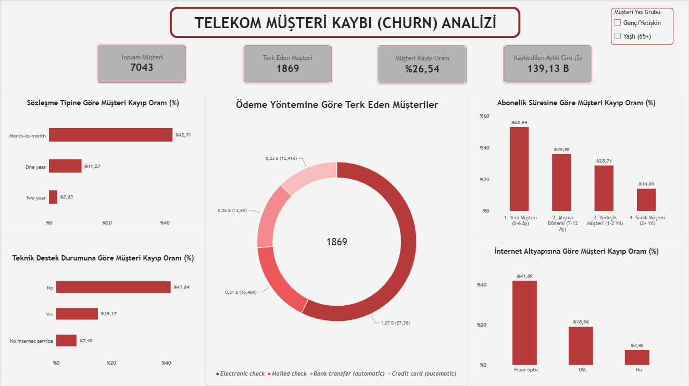

# Telekom Müşteri Kaybı (Churn) Analizi (MS SQL Server & Power BI)

Bu projede 7.000+ müşteriye ait **IBM Telco** telekomünikasyon veri seti üzerinde müşteri kaybı (Churn) nedenlerini, sözleşme türlerinin etkisini ve gelir kaybını MS SQL Server ve Power BI kullanarak analiz ettim.

## Kullanılan Araçlar
* **Veritabanı ve Analiz:** MS SQL Server (`NULL` temizliği, ilişkisel tablo ayrıştırma, `JOIN`, `GROUP BY`, `CASE WHEN`, `VIEW`)
* **Görselleştirme ve Raporlama:** Microsoft Power BI

## Yapılan İşlemler ve Temel Bulgular
* Ham veri üzerinde eksik veri (`NULL`) temizliği yapılarak veritabanı 3 ilişkisel tabloya ayrıldı.
* Sözleşme tipi, internet altyapısı ve abonelik süresi kırılımlarına göre müşteri kayıp oranları analiz edildi.
* Genel müşteri kayıp oranı **%26,54** (aylık yaklaşık **139,13 Bin $** gelir kaybı) olarak hesaplandı.
* Müşteri kaybının özellikle **ilk 6 aydaki yeni müşterilerde (%52,94)** ve **taahhütsüz (aylık) sözleşmelerde (%42,71)** yoğunlaştığı tespit edildi.
* Oluşturulan SQL `VIEW` yapısı Power BI'a aktarılarak etkileşimli bir Churn analiz paneli tasarlandı.

## Power BI Dashboard Görünümü

## Dosyalar
* `1_veri_temizleme.sql`: Eksik veri temizliği ve tablo düzenleme sorguları.
* `2_churn_analizi.sql`: Sözleşme, altyapı ve abonelik süresine göre Churn analiz sorguları.
* `3_powerbi_view.sql`: Power BI raporlaması için hazırlanan SQL VIEW sorgusu.
* `telco_churn_dashboard.pbix`: Power BI çalışma dosyası.
* `WA_Fn-UseC_-Telco-Customer-Churn.csv`: Projede kullanılan veri seti.
* `dashboard.png`: Tasarlanan Power BI panelinin ekran görüntüsü.
